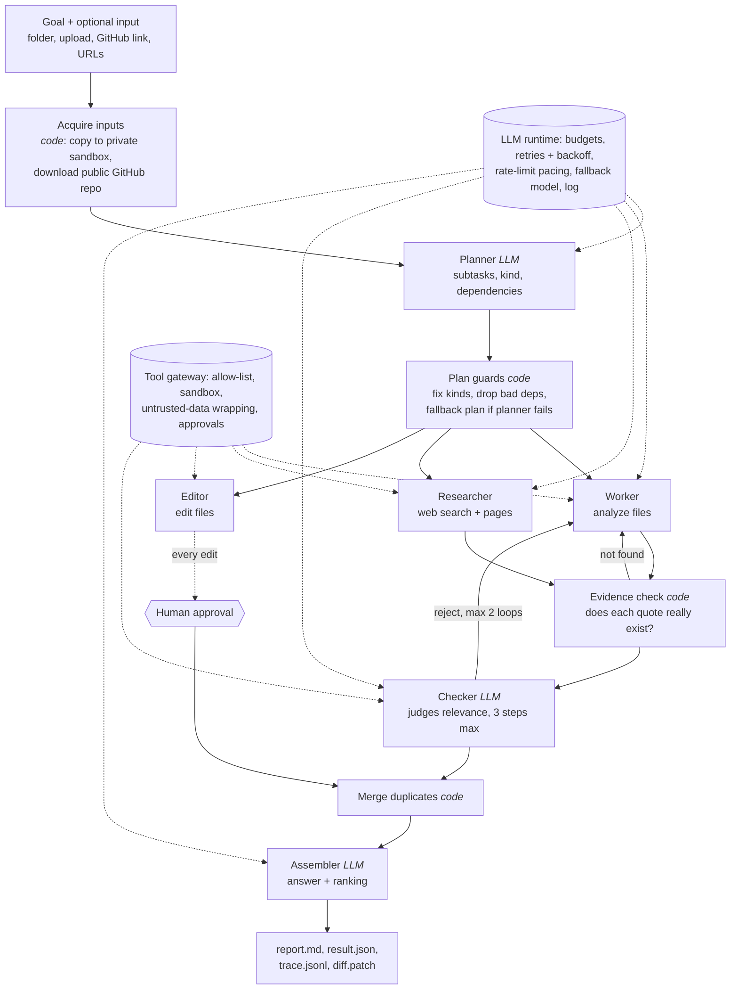

# ByteVox multi-agent harness

A harness that runs a small team of AI agents on a goal written in plain English, shows its work,
and still finishes when things go wrong. Give it a goal and some input (a folder, an upload, a GitHub
link, or nothing for web questions). A **planner** splits the goal, **workers / researchers / editors** do the
pieces in parallel, **code verifies every quote**, a **checker** judges the rest, and an **assembler**
writes the answer. Every step is recorded and replayable.

> The model is the easy part. Most of this repo is the part around it: limits, retries, permissions,
> approvals, verification and logs.



## Run it

Python 3.9+, **no packages to install** (standard library only).

```bash
# 1. a model: local and free ...
ollama pull qwen2.5:3b                  # https://ollama.com
# ... and/or a hosted one (much stronger). Set the key in your shell, never in code:
setx GROQ_API_KEY "<your key>"          # free key: console.groq.com   (open a NEW terminal after)
setx TAVILY_API_KEY "<your key>"        # optional web-search key; without it DuckDuckGo/Bing/Wikipedia are used

# 2. the web UI  -> http://127.0.0.1:8765
python server.py

# 3. or the command line
python run.py "Review this repo for bugs and security issues. Produce a prioritized list with evidence." --input samples/buggy_repo --provider groq --fallback ollama
python run.py "Review https://github.com/karpathy/micrograd for bugs" --provider groq
python run.py "Compare SQLite and PostgreSQL for a small web app, with sources" --provider groq
python replay.py <run_id>               # read any past trace

# 4. tests (no network, no key, a few seconds)
python tests/test_flows.py && python tests/test_rubric.py && python tests/test_compare.py

# 5. regenerate the comparison table (one run per cell, results are cached)
python compare.py --provider groq
```

Environment variables: `GROQ_API_KEY`, `TAVILY_API_KEY` / `BRAVE_API_KEY` (optional), `LLM_PROVIDER` (`ollama`|`groq`),
`LLM_FALLBACK`, `OLLAMA_MODEL` (default `qwen2.5:3b`), `GROQ_MODEL_FAST` / `GROQ_MODEL_STRONG` (default `qwen/qwen3.8-27b`),
and `HARNESS_<LIMIT>` to override any limit (for example `HARNESS_MAX_SECONDS=1800`). **Reviewers: use your own key via `GROQ_API_KEY`.**

## What it can do

| Goal | How it is handled |
|---|---|
| Review code (local folder, upload, or GitHub link) | repo downloaded, rule scan gives exact-line hints, workers read files, code verifies quotes |
| Answer a question from the web | researchers search (Tavily, else DuckDuckGo/Bing/Wikipedia), fetch pages, quote them; code verifies each quote is on the page |
| Triage / classify / summarise files | workers read and report findings with quoted evidence |
| Look something up, then change a file | research first, then an edit that waits for a human click; skipped if the research failed |
| Impossible goals ("book a flight") | planner refuses; refusals are challenged once if files exist |

The planner is not tied to any task. Its prompt is built from the tool lists and shows five unrelated example plans. It
chooses a *kind* per subtask (`analyze`, `research`, `edit`) and optional dependencies; the orchestrator is the same for all.

## How the eight requirements are met

| # | Requirement | Where / how |
|---|---|---|
| 1 | Roles, structured handoffs | `harness/agents.py`: planner, worker, researcher, editor, checker, assembler, each with its own prompt, tool list and JSON schema. Messages are validated JSON; invalid replies get one repair attempt. |
| 2 | Parallel + one shared state | `orchestrator._run_subtasks` (thread pool, dependency waves). One `RunState` (`state.json`, lock, atomic write). |
| 3 | Limits | `config.Limits`: calls, tokens, seconds for the run **and** per agent; checker capped at 3 steps. Timeouts are capped by the time left in the run. Clean stop, labelled PARTIAL. |
| 4 | Fail gracefully | Retries with exponential backoff and `Retry-After`; fallback model; circuit-breaker when a daily quota is gone; one failed subtask never stops others; fallback plan if the planner fails. |
| 5 | Verify | Code checks every quote exists (`verify_findings`), then the checker agent judges; up to 2 rejection loops, then the findings are kept but labelled *unverified*. |
| 6 | Least privilege + approval | Per-role allow-lists enforced in `Run.call_tool`; edits only inside a private copy and only after a human approves the diff (UI or terminal). |
| 7 | Untrusted content | Everything read is wrapped in `<untrusted_data>`, instruction-like text is flagged and logged, and **the defence is structural**: even an obeying model cannot call a tool it was not given. Demo: `examples/15_prompt_injection_flagged`. |
| 8 | Logging | `trace.jsonl`: agent, full prompt, tool call, result, tokens, seconds, for every step. UI has Activity, Safety log and Replay; CLI has `replay.py`. |

Optional extra chosen: **resuming a run after a crash** (see below). The human-approval screen is part of requirement 6 and is shown in the UI too.

## Limits and caps

**Time has one hard ceiling: 15 minutes (900 s)** for a run. It applies to the run, to each agent, to the web form,
the CLI, `HARNESS_MAX_SECONDS` and the comparison script, and a model call or a rate-limit wait is never allowed to outlast the run.

Anything that spends **model calls or tokens** is kept at its original conservative value, because the model provider
bounds it (free tiers cap tokens per minute and per day). A test pins these so they cannot drift upward:

| What | Value |
|---|---|
| Model calls per run / steps per agent | 40 / 6 (plus one reserved call so an agent can always give its answer) |
| Tokens per run / per agent | 150,000 / 40,000 |
| Subtasks per plan, checker rejection loops, parallel agents | 3, 2, 2 |
| A worker's reply | about 5 findings (reply length is provider-bound); asking for more shares the same 3 attempts, so it adds no calls |

Caps that belong to this code and **do not involve the model** are generous, and can be overridden with `HARNESS_<NAME>`:

| What | Value |
|---|---|
| GitHub download | 40 MB zip, 150 MB unpacked, 2,500 files (zip-bomb and path protections still apply) |
| Upload (web page) | 5 MB per file, 60 MB, 2,500 files (same protections) |
| Page fetch / file read | 1 MB page, 5 MB file (files are read in windows) |
| Search matches / folder listing / rule-scan file size | 100 / 600 / 2 MB |
| Network timeouts | 30 s for a page, 90 s for a GitHub download |

## Results: does the multi-agent version earn its cost?

Same model, same tools, same three tasks, same rubric, one run per cell. The rubric is computed by code, not by a model
or by me. It scores **Recall** (planted ground truth found *with a real quote*), **Groundedness** (are the quotes real?) and
**Distinctness** (no duplicates), 0-5 each. Cost is shown as model calls and tokens: both models ran on free tiers, so
dollars are $0. Full tables: `comparison/COMPARISON.md`, `comparison/COMPARISON_local3b.md`.

**Hosted model (Groq `qwen/qwen3.8-27b`)**

| Task | Version | Score /15 | Time | Calls | Tokens |
|---|---|---|---|---|---|
| Code review | multi-agent | 14.2 | 122 s | 12 | 13,370 |
| Code review | single agent | 14.2 | 1.3 s | 2 | 2,145 |
| Ticket triage | multi-agent | **15.0** | 122 s | 12 | 11,015 |
| Ticket triage | single agent | 13.3 | 61 s | 6 | 5,930 |
| Web research | multi-agent | 15.0 (PARTIAL) | 607 s | 22 | 40,523 |
| Web research | single agent | 15.0 | 554 s | 12 | 29,430 |
| **Total** | multi / single | **44.2 / 42.5** (of 45) | 851 s / 616 s | | 64,908 / 37,505 (1.7x) |

**Weak local model (Ollama `qwen2.5:3b`, free)**

| Task | Version | Score /15 | Found | Time | Calls | Tokens |
|---|---|---|---|---|---|---|
| Code review | multi-agent | **13.3** | 4 of 6 issues | 230 s | 14 | 15,114 |
| Code review | single agent | 10.0 | 0 of 6 | 287 s | 12 | 27,653 |
| Ticket triage | multi-agent (PARTIAL) | **13.3** | 2 of 3 tickets | 187 s | 28 | 23,977 |
| Ticket triage | single agent | 10.0 | 0 of 3 | 172 s | 14 | 33,077 |

### What this says, honestly
- **The weaker the model, the more the structure helps.** On the 3B model the single agent found *nothing relevant* on both tasks
  (it flailed for 12-14 calls) while the team found real issues, and used **fewer** tokens (0.6x). The planner narrows each
  worker's job, the rule scan hands it candidate lines, and code rejects invented quotes.
- **On a strong model with a small input, it mostly is not worth it.** Code review of two files: *identical* results (both missed
  the `age > 18` boundary), but 6.2x the tokens and ~90x the time. Research: identical quality, 1.4x the tokens, and a PARTIAL label.
  The only quality gain (triage, +1.7) is **one ticket** the single agent rated "medium" instead of "high", which could be noise.
- **The verification layer showed no measurable benefit on the strong model**: both versions scored 5/5 groundedness because the 27B
  model never invented a quote. It earned its keep on the weak model (see `examples/11_failure_empty_result_called_complete` and
  the invented quotes rejected in the 3B traces), which is a different claim from "it always helps".
- **Where the extra cost is worth paying:** weak or small models, ambiguous tasks that benefit from a second opinion, work that must
  be auditable (a trace of who checked what), and risky actions that need a gate. **Where it is not:** small inputs, strong models,
  and anything a single prompt already does well.
- **Caveats:** one run per cell, so differences under ~2 points are noise. The ground truth and the samples were authored by the same
  person who built the harness, which can flatter it. The research check is keyword-based. The rubric scores the findings list, not the
  prose summary. The hosted multi-agent runs happened **before** the checker step-cap fix below; the local runs happened after it.
  Time on the hosted model includes rate-limit waiting, which hurts the team more because its agents share one token budget.

## The run that went wrong, and what changed

In the hosted research comparison the team ended **PARTIAL** (`examples/05_research_hosted_multi_PARTIAL`) although its answer scored 15/15.
The trace shows why: the **checker agent spent all 6 of its steps** re-reading pages that code had *already* verified, hit its step limit
and never returned a verdict, so subtask s1 was marked "unchecked".

What the harness did: it stopped that agent cleanly, kept the findings (all quotes verified), let the other subtask finish, labelled the whole
result PARTIAL with the exact reason, and logged everything. What I changed: the checker now has its own 3-step cap, is forced to give a
verdict on its last step, and its prompt says the quotes are already proven. `test_a_checker_that_wanders_cannot_stall_the_run` reproduces the
failure with a scripted model. I did not re-measure it live, to save tokens, so the table above shows the pre-fix behaviour.

A second real-use bug: on an open web question (`examples/18_open_question_web_research`) the checker kept rejecting correct quotes, because my HTML-to-text step put every link on its own line (`herbal medicines , special diets`), so a sentence copied naturally failed the exact-match check. Sentences are now kept whole, and the match ignores formatting-only differences (citation markers like `[12]`, spaces before punctuation, curly quotes) while the words themselves must still match exactly; `test_web_text_keeps_sentences_whole_and_natural_quotes_verify` covers it.

A third, found by testing on a fresh project nobody had tuned for (`examples/20_failure_agent_ran_out_of_steps_files_never_reviewed`): one worker kept calling tools until its step limit, never answered, and its whole subtask was lost, so three source files were never reviewed and the SQL injection was missed. The run said PARTIAL correctly, but the work was wasted. An agent that runs out of steps now gets one last call that can only answer (`test_an_agent_that_runs_out_of_steps_is_asked_for_its_answer_not_discarded`). The same run showed two smaller losses, also fixed: a model wrote tool arguments beside the tool name instead of inside `args` (rejected twice, wasting two of six steps; both spellings are now accepted), and one worker returned exactly the cap of 5 findings so the rest were silently dropped (a full answer now triggers a follow-up pass that asks for NEW, different findings; `test_a_worker_that_fills_its_quota_is_asked_for_more`). Scored against the planted answer key the original run found 9 of 20 issues, every one real, checked and correctly ranked: it was precise but incomplete. These fixes are tested with a scripted model but not yet re-measured live.

Other failures that shaped the design (all with traces in `examples/`): workers returning zero findings to escape rejection and the run saying
COMPLETE (11); a daily token quota retried every minute for 9 minutes (12); a small model refusing a doable task (13).

## Optional extra: resume after a crash

A run is saved after every step, so if the process dies (power cut, a server restart, a kill) nothing finished is lost.

- **What is kept:** every finished subtask, the plan (no second planner call), the whole trace (numbering and run clock continue),
  and the model calls already spent.
- **What re-runs:** only the unfinished subtasks, and any edit that depends on them.
- **It cannot extend the limits.** Time already used counts against the 15-minute ceiling and calls against the call budget
  (`test_resuming_can_never_extend_the_time_limit`). Downtime itself is not counted.
- **Where:** a **Resume this run** button on any interrupted run in the page, or `python run.py --resume <run_id>`.
  Runs saved before this existed have no `run.json` and are labelled as not resumable.

Demo, with a real model: `--demo-crash-after N` hard-kills the process (exit code 86) once N subtasks have finished, then resume it.

```bash
python run.py "<goal>" --input <folder> --provider groq --run-id demo --demo-crash-after 1
python run.py --resume demo --provider groq
```

Measured: a 14-ticket triage was killed while subtask s1 was mid-run and s2 was already approved. Resume kept s2, re-ran only s1,
did not plan again, carried the clock over (183 s to 306 s, 11 to 17 model calls) and finished COMPLETE with all 14 urgencies correct
(`examples/21_resume_after_crash_14_tickets`). Known limit: a subtask that was mid-run restarts from its beginning, not from its last step.

## Decisions and trade-offs

- **Code does the checking, the model does the judging.** Whether a quote exists is a string match; asking a model costs tokens and can be wrong.
  The model decides what to read and what it means.
- **The rules live outside the model.** Permissions, sandbox, approvals and limits are enforced in `Run.call_tool` / `Run.llm_call`, so a
  hijacked or confused agent cannot bypass them.
- **A JSON tool protocol instead of native function-calling.** It works the same on Ollama and Groq. The cost: `openai/gpt-oss-*` insisted on
  Groq's native format and failed, so the default is `qwen/qwen3.8-27b` (a *preview* model that Groq may remove; the local fallback covers that).
- **Honest labels over green ticks.** A run that hit a limit, used a fallback model, or found nothing says so on the banner.
- **Standard library only.** Nothing to install, nothing to break on a new machine.
- **Rate-limit pacing is client-side.** Free tiers cap tokens per minute and per day; waiting politely beat being rejected and retrying.
- **Web search is a chain**, Tavily (reliable) then scraped DuckDuckGo/Bing (best effort, can break) then Wikipedia.

## What I cut for time

- **Cost-aware model routing.** Roles have "fast"/"strong" tiers in `config.py`, but both default to the same model.
- **Line-by-line coverage tracking** for reviews (a ledger proving every chunk was read) and a **cross-subtask consistency check** (one triage ticket can still get two urgencies).
- **MCP exposure.** Not built.
- **Not supported:** PDFs/images, JavaScript-only or logged-in web pages, private repos, running code.
- **Soft limits:** a model call already in flight finishes, so a run can overshoot its time limit slightly.
- **Statistical rigour:** one run per comparison cell.

## Hours spent

**[FILL IN: total hours, and roughly how they split across design, building, testing, writing.]**

## How I used AI, and where it was wrong

AI (Claude) helped design and write the code, tests and this README, and I directed and reviewed it. **[FILL IN / edit this paragraph in your own words, and be ready to explain every file.]**

Where it was wrong, and how it was caught:
1. **It reported a guardrail that did not exist.** It told me workers could not answer before reading a file, but the patch had silently failed on a string mismatch. It was caught later by reading the file, then fixed and covered by a test (`grounding_required`).
2. **It recommended models that no longer existed.** It suggested Groq's Llama models from a stale documentation page; they had been shut down. I caught it, and the deprecations page (not the models page) turned out to be the reliable one.
3. **Generated code was mangled by escaping**: a regex `\b` became a backspace character and a newline escape split strings. Syntax errors and a missing SQL-injection finding exposed it; the fix was writing code with the edit tools and testing the rule scanner against known answers.
4. **Its first "weak evidence" heuristic was too strict** and flagged a correct quote, and the weak local checker then rejected a legitimate finding because of it. A scripted test caught the over-flagging; the check now applies to prose sources only.

## Layout

```
run.py  server.py  replay.py  compare.py     CLI, web UI server, trace viewer, comparison runner
ui/index.html                                the web UI (single file, no framework)
harness/
  orchestrator.py   plan -> subtasks (in dependency order) -> verify -> merge -> assemble; plan guards, fallback plan
  agents.py         the roles: prompts, tool allow-lists, output schemas
  runtime.py        every model call and tool call goes through here: budgets, retries, pacing, gateway
  tools.py          list/read/search files, fetch_url, web_search, github_fetch, edit_file (approval), calculate, ...
  staticscan.py     rule-based code checks with exact lines (no model)
  websearch.py      Tavily/Brave -> DuckDuckGo -> Bing -> Wikipedia
  llm.py            Ollama + Groq adapters, token pacers, circuit breaker
  safety.py         untrusted-data wrapping, injection flags, approval gate
  baseline.py       the single-agent baseline     rubric.py   the scoring rubric
  budget.py logger.py state.py config.py
tests/              test_flows.py (28), test_rubric.py (6), test_compare.py (1): scripted model, no network
samples/            buggy_repo (6 planted issues), injection_repo, notes (3 tickets)
comparison/         results and tables          examples/   19 curated run traces with an INDEX
```
